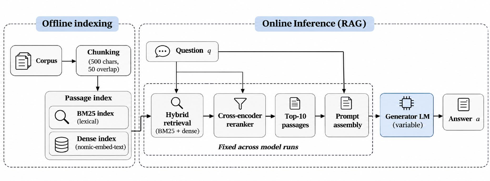
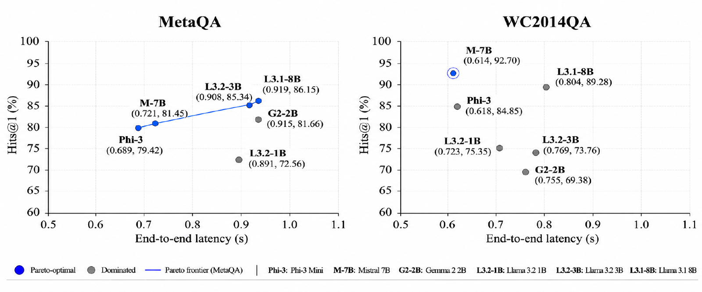

# Beyond Parameter Count: Selecting Compact Language Models for Retrieval-Augmented Generation

Evaluation code and per-question results for the paper:

**Beyond Parameter Count: Selecting Compact Language Models for Retrieval-Augmented Generation**  
Alexandros Papafragkakis, Yannis Tzitzikas  
University of Crete & FORTH-ICS

To appear in the Proceedings of the 14th EETN Conference on Artificial Intelligence (SETN 2026), Chania, Greece, September 9–11, 2026. ACM.  
DOI: [10.1145/3860954.3860972](https://doi.org/10.1145/3860954.3860972) (active once the proceedings are published in the ACM Digital Library)

## Overview

We compare six compact open-source language models (1B–8B parameters) as the generator of a RAG pipeline. Retrieval, reranking and the prompt template are the same for every run, so differences come from the generator.



We report Hits@1, F1 and Exact Match, McNemar tests for every pair of models, and latency split into retrieval and generation.

## Key Findings

- Parameter count is an unreliable predictor of RAG accuracy across the compact model families we evaluate.
- MetaQA: Gemma 2 2B and Mistral 7B are statistically tied (81.66% vs 81.45% Hits@1, p = 0.588). Llama 3.2 3B is within 0.8pp of Llama 3.1 8B.
- WC2014QA: Mistral 7B beats Llama 3.1 8B (92.70% vs 89.28%, p < 0.001) with about 24% lower end-to-end latency (0.61s vs 0.80s).
- Retrieval latency is roughly the same for all generators. Generation latency depends on architecture, not size: Phi-3 Mini and Mistral 7B are the fastest.
- RAG improves Hits@1 by +49.6pp to +84.5pp for all models.

## Results

Hits@1 with RAG and mean end-to-end latency per query:

| Model | MetaQA H@1 (%) | MetaQA latency (s) | WC2014QA H@1 (%) | WC2014QA latency (s) |
|---|---:|---:|---:|---:|
| Llama 3.2 1B | 72.56 | 0.891 | 75.35 | 0.723 |
| Gemma 2 2B | 81.66 | 0.915 | 69.38 | 0.755 |
| Llama 3.2 3B | 85.34 | 0.907 | 73.76 | 0.769 |
| Phi-3 Mini 3.8B | 79.42 | **0.689** | 84.85 | 0.618 |
| Mistral 7B | 81.45 | 0.721 | **92.70** | **0.614** |
| Llama 3.1 8B | **86.15** | 0.919 | 89.28 | 0.804 |



Full tables (baseline vs RAG, F1, EM, all McNemar tests, latency breakdown) are in [docs/results.md](docs/results.md). Metric definitions are in [docs/metrics.md](docs/metrics.md).

### Which model to use

| Scenario | Model | Why |
|---|---|---|
| Factual / entity extraction (like WC2014QA) | Mistral 7B | Highest accuracy, significantly beats the 8B model, lowest latency |
| Multi-entity QA (like MetaQA) | Llama 3.2 3B | 0.80pp below the 8B model with less than half the parameters |
| Strict latency budget (< 0.7s) | Phi-3 Mini | Only model under 0.7s end-to-end on both benchmarks |
| Size-constrained (≤ 3B) | Llama 3.2 3B | Best accuracy in the ≤ 3B tier on MetaQA |

## Setup

- **Models:** Llama 3.2 1B, Gemma 2 2B, Llama 3.2 3B, Phi-3 Mini 3.8B, Mistral 7B, Llama 3.1 8B
- **Benchmarks:** MetaQA 1-hop (9,947 test questions, movies) and WC2014QA (6,482 test questions, 2014 FIFA World Cup)
- **Retrieval:** SemanticRAG (Sapidis et al., TPDL 2025) through its HTTP API. Hybrid search (BM25 + nomic-embed-text), cross-encoder reranking (gte-reranker-modernbert-base), top-10 passages, 500-character chunks with 50 overlap
- **Generation:** temperature 0, `max_new_tokens=128`, 4-bit NF4 quantization (bitsandbytes), batch size 1
- **Hardware:** single 16 GB GPU (AMD Radeon RX 9070 XT) on the remote server
- **Latency:** measured on the client as the HTTP round-trip, so it includes network time

See Section 3 of the paper for details.

## Repository Layout

```
data/       test questions (metaqa.jsonl, wc2014qa.jsonl, WC-P1.txt)
src/        scripts that query the API and score the answers
tools/      scripts that aggregate results into tables and latency summaries
out/        per-question outputs for every model, with and without RAG
docs/       full results, metric definitions, figures
```

Every line in `out/` is one question, with the gold answer(s), the model prediction, the correctness flags and the retrieval and generation latency. The numbers in the paper are computed from these files.

## Reproducing

The scripts call the SemanticRAG HTTP API, which is not publicly available. Without it you can still recompute every metric and significance test from the outputs in `out/`.

## Citation

```bibtex
@inproceedings{papafragkakis2026beyond,
  author    = {Papafragkakis, Alexandros and Tzitzikas, Yannis},
  title     = {Beyond Parameter Count: Selecting Compact Language Models for Retrieval-Augmented Generation},
  booktitle = {Proceedings of the 14th EETN Conference on Artificial Intelligence (SETN 2026)},
  year      = {2026},
  publisher = {ACM},
  address   = {New York, NY, USA},
  doi       = {10.1145/3860954.3860972}
}
```

## Acknowledgments

We thank the Information Systems Laboratory (ISL) at FORTH-ICS for access to the SemanticRAG infrastructure and computational resources. This work is supported by the ECHOES project, funded by the European Union under Horizon Europe, Grant Agreement No. 101157364.
