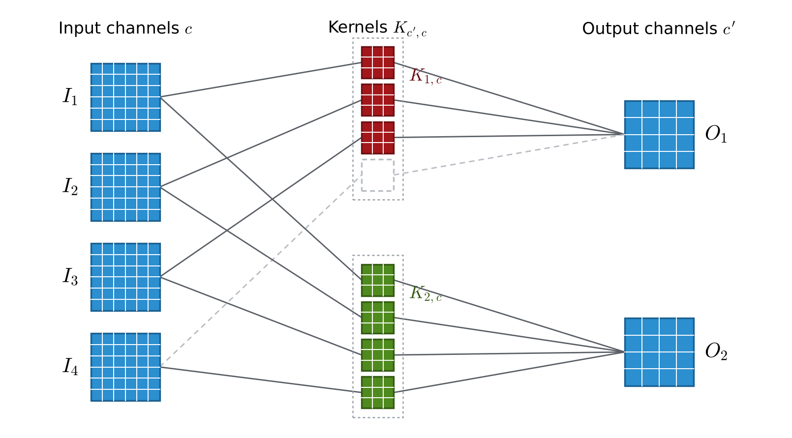
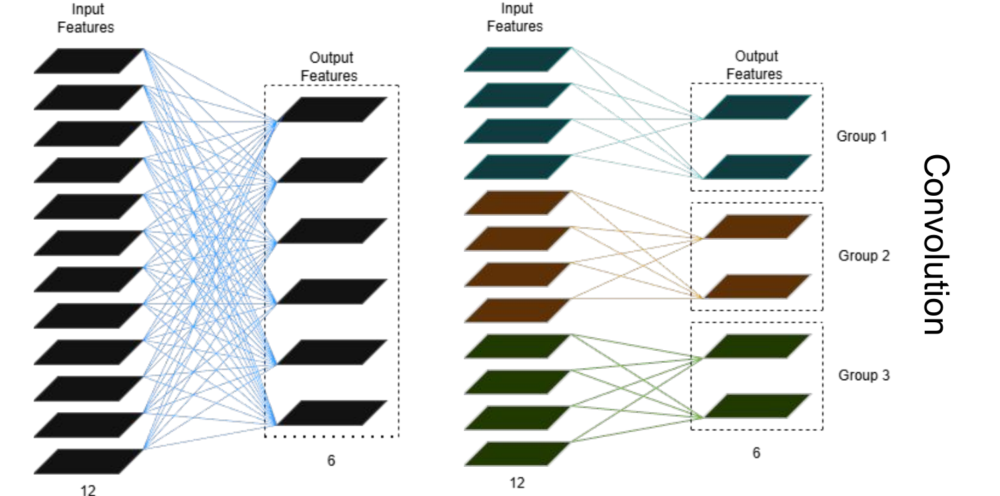
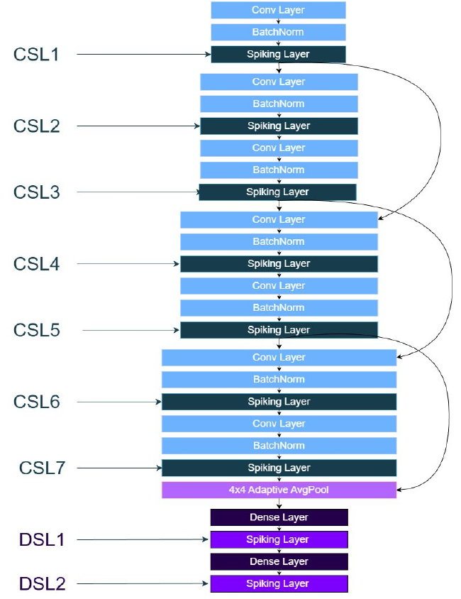
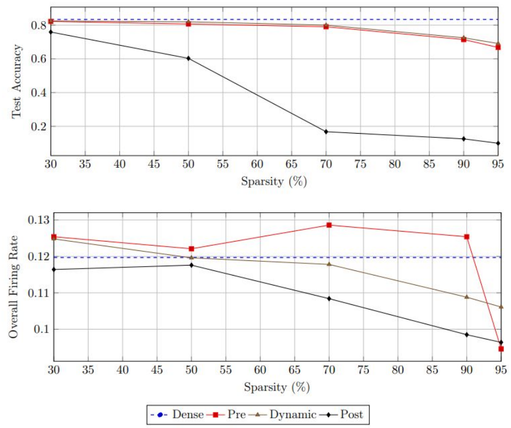
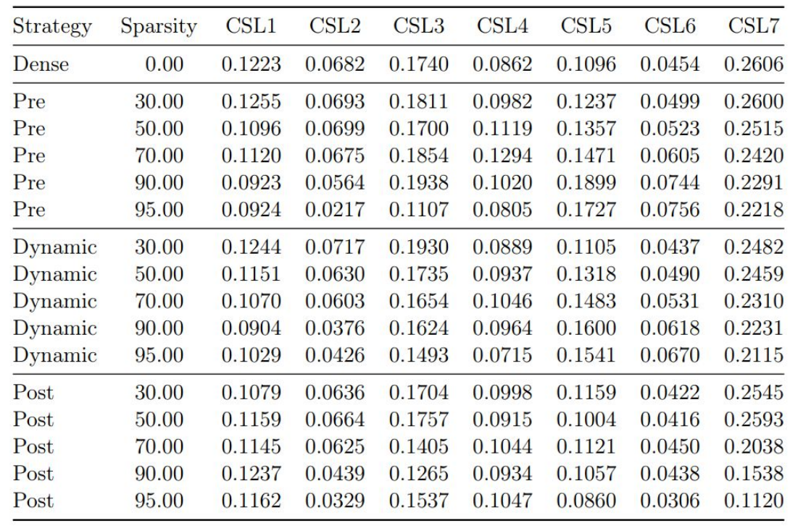
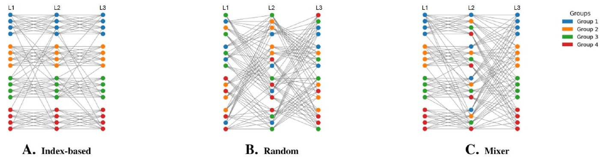
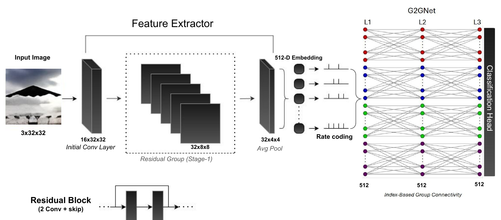
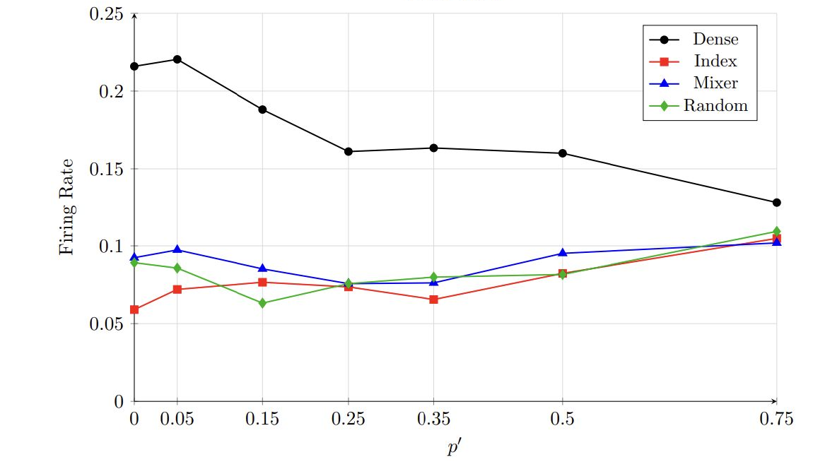
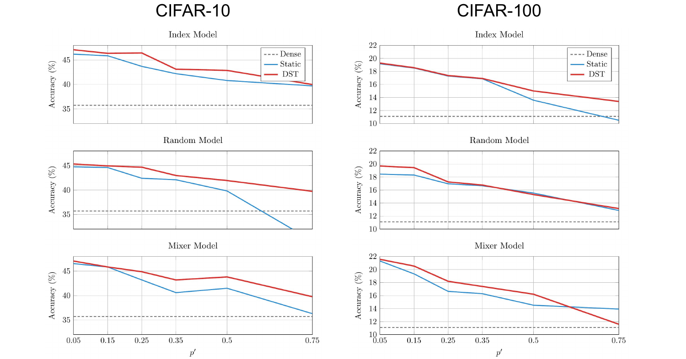

# Structured Sparsity in Spiking Neural Networks

Edge pruning in spiking CNNs, G2G (group-to-group) connectivity and Dynamic Sparse Training in spiking MLPs.

Alexandros Papafragkakis

Full report: [REPORT.pdf](REPORT.pdf)

## Highlights

- **Spiking CNN on CIFAR-10:** dynamic pruning beats pre-training pruning at every sparsity level (79.99% vs 79.04% at 70%, 69.11% vs 66.76% at 95%). Post-training pruning collapses above 50% sparsity (16.80% at 70%).
- **ResNet–SNN on CIFAR-10:** sparse G2G classifiers match the dense SNN (93.4–93.5%) with 2–3.7× lower firing rate for p′ ≤ 0.5. At p′ = 0, Index reaches 93.47% at a firing rate of 0.059, against 93.44% at 0.216 for Dense.
- **Dynamic Sparse Training:** improves static sparsity by up to +2.7 points and keeps Random from collapsing at p′ = 0.75 on CIFAR-10 (29.6% → 39.7%).

## Edge Pruning in Spiking CNNs

### Convolution as a graph

A convolutional layer is a bipartite graph. Every input channel c and every output channel c′ is a node, and the kernel K(c′,c) is the edge between them.



Four input channels, two filters with one 3×3 kernel per input channel, and two output channels. The dashed edge I₄ → O₁ is ablated: its kernel is zero.

The contribution of edge c → c′ at output position (x, y) is

```math
E_{c \to c'}(x, y) = \sum_{i=0}^{k-1} \sum_{j=0}^{k-1} I_c(x+i,\, y+j)\, K_{c',c}(i, j)
\qquad\text{or}\qquad
E_{c \to c'} = I_c * K_{c',c}
```

and the output feature map of channel c′ is the sum over all incoming edges:

```math
O_{c'}(x, y) = \sum_{c=0}^{C-1} \sum_{i=0}^{k-1} \sum_{j=0}^{k-1} I_c(x+i,\, y+j)\, K_{c',c}(i, j)
\qquad\text{or}\qquad
O_{c'} = \sum_{c=0}^{C-1} I_c * K_{c',c}
```

Ablating an edge sets its kernel to zero, so channel c no longer contributes to c′:

```math
K_{c',c}(i, j) = 0 \;\; \forall i, j \quad\Rightarrow\quad E_{c \to c'} = 0
```

If other edges carry the same information (for example, other channels that also detect corners), the output channel barely changes. If the edge was the only one carrying it, the output channel loses that information.

### Standard vs grouped convolution



In a standard convolution every output channel is connected to every input channel, even though many input channels carry similar information. In a grouped convolution the channels are split into groups and each group only uses its own channels. This removes connections from the start, avoids mixing unrelated features, and lets each group learn different features. It is the same idea as G2G connectivity in the spiking MLPs below.

### Network



`KS32_FullySpiking_Small` has seven convolutional spiking layers (CSL1–CSL7, each conv + batch norm + spiking neurons) with residual connections between selected blocks, a 4×4 adaptive average pooling layer and two dense spiking layers (DSL1–DSL2). All activations are binary spikes.

### Pruning strategies

- **Pre:** a fixed percentage of edges is removed at random before training, and the topology stays fixed
- **Dynamic:** starts like Pre, then at regular intervals removes the least important active edges and re-activates the same number of inactive ones at random, so the sparsity stays constant
- **Post:** the dense network is trained first, then the least important edges are removed and the network is fine-tuned

Edge importance is the L1 norm of the kernel:

```math
\text{importance}(c \to c') = \lVert K_{c',c} \rVert_1 = \sum_{i,j} \lvert K_{c',c}(i, j) \rvert
```

A norm close to zero means the kernel has almost no effect on the output, so the edge is a safe candidate for removal.

<br clear="right">

### Results (CIFAR-10)

T = 4, 50 epochs, SGD (momentum 0.9, weight decay 5×10⁻⁴) with cosine annealing. Dense: **83.37%**.

| Sparsity | Pre | Dynamic | Post |
|---|---|---|---|
| 30% | 82.19 | **82.46** | 75.90 |
| 50% | 80.68 | **81.98** | 60.30 |
| 70% | 79.04 | **79.99** | 16.80 |
| 90% | 71.44 | **72.50** | 12.57 |
| 95% | 66.76 | **69.11** | 9.96 |



Dynamic pruning works best because it decides which edges to remove after the network has started learning, and it changes the topology a little at a time. Post-training pruning removes too much at once at high sparsity, and fine-tuning cannot recover.

Layerwise firing rates. CSL7 fires the most because it has to integrate everything regardless of sparsity. Dynamic pruning gives smooth, slowly decreasing profiles, while Post collapses at high sparsity.



## G2G Connectivity in Spiking MLPs

The classifier is a spiking MLP with three hidden LIF layers. In the G2G models each layer is split into 8 groups. Connections inside a group are always active (p = 1). Connections between groups are kept with probability **p′**, so a higher p′ means more inter-group connections and a denser network.

- **Index:** contiguous blocks of neurons, which keeps spatial locality across layers
- **Random:** random assignment, which keeps the sparsity but removes the structure
- **Mixer:** index-based groups in the first and last hidden layer and interleaved groups (neuron l in group l mod G) in the middle one, so features mix across groups in a controlled way



**Dense** is the fully connected baseline. For comparisons it is capacity-matched to the sparse models.

### ResNet–SNN (CIFAR-10)



A frozen, truncated ResNet-32 pretrained on CIFAR extracts features (cut after `layer1`, followed by average pooling). The features are min–max normalized per sample, rate-encoded into spike trains and classified by the G2G spiking MLP. Accuracy saturates, so firing rate becomes the main difference between models.

| p′ | Dense* | Index | Mixer | Random |
|---|---|---|---|---|
| 0.00 | 93.44 / 0.2159 | **93.47 / 0.0590** | 93.43 / 0.0924 | 93.39 / 0.0892 |
| 0.15 | 93.48 / 0.1881 | 93.49 / 0.0766 | **93.50** / 0.0852 | 93.45 / **0.0632** |
| 0.50 | **93.51** / 0.1600 | 93.37 / 0.0823 | 93.43 / 0.0952 | **93.51 / 0.0816** |
| 0.75 | 93.42 / 0.1283 | 93.46 / 0.1048 | **93.49 / 0.1019** | 93.36 / 0.1093 |

Best test accuracy (%) / overall firing rate. \*Dense is fully connected and capacity-matched to the sparse models at each p′.



### Static sparsity vs Dynamic Sparse Training (CIFAR-10 / CIFAR-100)

DST keeps the number of connections fixed and rewires them during training. Every 1,000 steps it prunes 10% of the active connections and grows the same number of new ones.

| Pruning (`--cp`) | Removes | Growth (`--cg`) | Adds |
|---|---|---|---|
| `set` | smallest-magnitude weights | `random` | random inactive edges |
| `random` | random edges | `hebb` | edges with high pre/post co-activation |
| `hebb` | edges with low pre/post co-activation | | |



- Sparse models beat the dense SNN (35.7% on CIFAR-10, 11.1% on CIFAR-100) everywhere except static sparsity at p′ = 0.75 (Random on CIFAR-10, Index on CIFAR-100).
- With DST, all architectures peak at p′ = 0.05. On CIFAR-10: Index 47.10%, Mixer 47.07%, Random 45.33%. On CIFAR-100: Mixer 21.57%, Random 19.68%, Index 19.27%.
- DST helps most where static sparsity struggles, e.g. Random at p′ = 0.75 on CIFAR-10 goes from 29.6% to 39.7%.

## Code

- `src/train_cnn.py`: edge pruning in the spiking CNN
- `src/train.py`: the Dense, Index, Random and Mixer spiking MLPs with static or dynamic sparsity, with or without the ResNet feature extractor
- `src/crossval.py`: k-fold cross-validation for the spiking MLPs
- `src/run_ablation_one.py`: intra-group ablation of a trained spiking MLP

### Installation

Requires Python 3.12+.

```bash
python -m venv venv
source venv/bin/activate        # Windows: venv\Scripts\activate
pip install -r requirements.txt
```

For an NVIDIA GPU, install the CUDA build of PyTorch first ([pytorch.org](https://pytorch.org/get-started/locally/)), for example:

```bash
pip install torch torchvision --index-url https://download.pytorch.org/whl/cu128
```

On Windows with an AMD GPU you can use DirectML (`pip install torch-directml`), but it needs a PyTorch version that DirectML supports. The device is picked automatically: DirectML, then CUDA, then CPU.

Datasets are downloaded to `data/` the first time you run.

### Spiking CNN pruning

Run from the repository root:

```bash
python src/train_cnn.py --strategy STRATEGY --sparsity SPARSITY [OPTIONS]
```

| Argument | Description | Default |
|---|---|---|
| `--strategy` | `dense`, `pre`, `dynamic`, `post` | `dense` |
| `--sparsity` | fraction of edges removed in each pruned layer | `0.5` |
| `--dataset` | `cifar10`, `cifar100` | `cifar10` |
| `--epochs`, `--T`, `--batch_size` | training epochs, timesteps, batch size | `50`, `4`, `256` |
| `--lr`, `--momentum`, `--weight_decay` | SGD with cosine annealing | `0.1`, `0.9`, `5e-4` |
| `--update_every`, `--update_frac`, `--update_until` | dynamic: epochs between updates, fraction of active edges replaced, fraction of training with updates | `1`, `0.1`, `0.75` |
| `--finetune_epochs`, `--finetune_lr` | post: fine-tuning after pruning | `10`, `0.01` |
| `--prune_first_layer` | also prune CSL1 (kept dense by default, it has only 3 input channels) | off |
| `--enc` | `direct` (image repeated T times) or `rate` | `direct` |

```bash
python src/train_cnn.py --strategy dense
python src/train_cnn.py --strategy dynamic --sparsity 0.7
```

The defaults follow the training setup in the report. At the end it prints the test accuracy, the overall firing rate and the firing rate of each CSL. Use `--seed` for repeatable runs.

### Spiking MLPs

Run from the repository root:

```bash
python src/train.py --dataset DATASET --model MODEL [OPTIONS]
```

| Argument | Description | Default |
|---|---|---|
| `--dataset` | `fashionmnist`, `cifar10`, `cifar100` | `fashionmnist` |
| `--model` | `dense`, `index`, `random`, `mixer` | `dense` |
| `--p_inter` | inter-group connection probability p′ (sparse models) | `0.15` |
| `--hidden_dim` | neurons per hidden layer | `2048` |
| `--epochs` | training epochs | `20` |
| `--T` | simulation timesteps | `50` |
| `--batch_size` | batch size | `256` |
| `--enc` | input encoding without ResNet: `current` (analog input) or `rate` (Bernoulli spikes) | `current` |
| `--enc_scale`, `--enc_bias` | scale and bias applied to the input before encoding | `1.0`, `0.0` |
| `--use_resnet` | frozen ResNet-32 feature extractor (CIFAR only) | off |
| `--sparsity_mode` | `static` or `dynamic` (DST) | `static` |
| `--cp` | DST pruning rule: `set`, `random`, `hebb` | `set` |
| `--cg` | DST growth rule: `hebb`, `random` | `hebb` |
| `--enforce_sparsity` | firing-rate regularization | off |
| `--warmup_epochs` | epochs before the regularization starts | `10` |

Training uses Adam (lr 1e-3, weight decay 1e-4) and cross-entropy on the output spike counts. At the end it prints the per-layer firing rates. No random seed is fixed, so results vary slightly between runs.

### Examples

```bash
# CIFAR-10, Mixer with static sparsity
python src/train.py --dataset cifar10 --model mixer --p_inter 0.05

# CIFAR-10, Index with DST (Hebbian pruning and growth)
python src/train.py --dataset cifar10 --model index --p_inter 0.05 --sparsity_mode dynamic --cp hebb --cg hebb

# ResNet–SNN on CIFAR-10
python src/train.py --dataset cifar10 --model index --use_resnet --p_inter 0.15 --hidden_dim 512
```

The sweeps used for the report are in `scripts/` (Windows batch files).

### Cross-validation

`src/crossval.py` takes the same arguments as `train.py`, plus `--k_folds` (default 5). Each fold trains for `--epochs` epochs (default 5 here). The output can be collected with `tools/cv_results.py`:

```bash
mkdir results_cv_5fold_5ep_p_sweep
python src/crossval.py --dataset cifar10 --model index --p_inter 0.05 > results_cv_5fold_5ep_p_sweep/index_p0.05.txt
python tools/cv_results.py
```

### Checkpoints

Each run saves a checkpoint to `checkpoints/` after every epoch and resumes from it if interrupted. When a run finishes, a `.DONE` file is created and the same run is skipped next time. Delete the `.DONE` file to run it again.

### Intra-group ablation

`src/run_ablation_one.py` loads a trained checkpoint, keeps only the intra-group connections and reports the accuracy drop. It takes the same arguments as `train.py`:

```bash
python src/run_ablation_one.py --dataset cifar10 --model index --p_inter 0.05
```

## Repository Layout

```
models/     Dense, Index, Random and Mixer SNNs, spiking CNN, frozen ResNet feature extractor
src/        training scripts, cross-validation, intra-group ablation
data/       dataset loaders (datasets are downloaded here)
utils/      input encoding
tools/      scripts that collected result tables from the original sweep logs
scripts/    sweep scripts used for the report
docs/       figures used in this README
REPORT.pdf  full report
```

## License

The code is released under the [MIT License](LICENSE).
